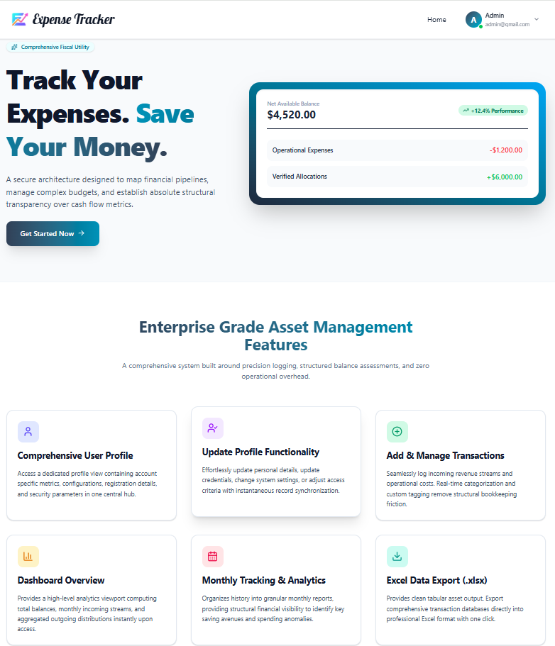
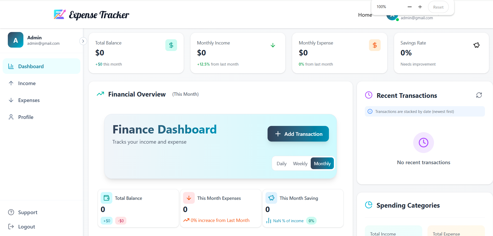
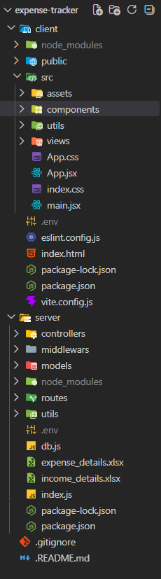

# 💰 Expense Tracker

A Full Stack ***Expense Tracker*** application built using the MERN Stack. It helps users manage their daily income and expenses, track transactions, and maintain their financial records efficiently.

---

## Live Website
https://expense-tracker-j6np.onrender.com/

---

## Pages
- Home
- SignUp & Login
- Dashboard
- Expense
- Income
- Profile Update

---

## Feature
- User Authentication
- Password Security
- Add Transactions
- Update Transactions
- Delete Transactions
- Expense Management
- Transaction History
- Excel Export

---

## Technologies Used
- **Frontend**: React.js, JavaScript, Tailwind CSS
- **Backend**: Node.js, Express.js
- **Database**: MongoDB
- **Tools**: Git, GitHub, Postman, Vite

---

## Home Page

---

## Dashboard

---

## Project Structure

